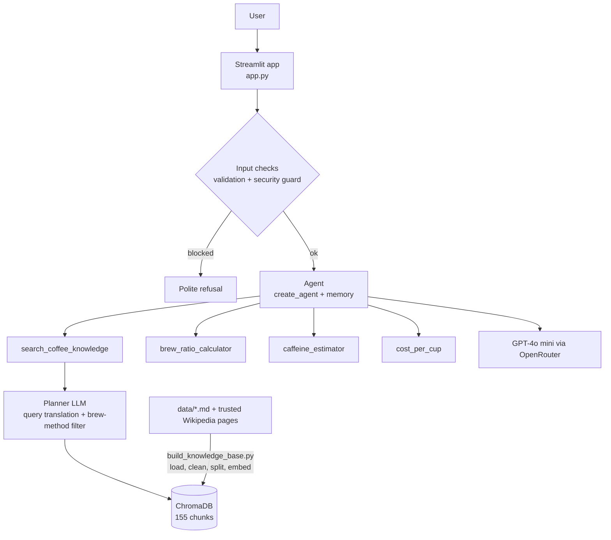

# ☕ Home Barista Assistant

A domain-specialised chatbot that helps people brew better coffee at home. It answers brewing and taste questions from a curated coffee knowledge base (RAG), and uses tools for exact calculations: water for a coffee dose, caffeine in a drink, and cost per cup.

Built with **LangChain**, **OpenRouter**, **ChromaDB** and **Streamlit** for the Turing College AI Engineering Sprint 2 project.

---

## Features

**Advanced RAG**
- Knowledge base of 2 hand-written guides (troubleshooting, brewing) and 6 Wikipedia articles, cleaned and split into 155 chunks
- Embedding search with OpenAI `text-embedding-3-small` (via OpenRouter) in ChromaDB, cosine similarity
- **Query translation:** vague or slang questions are rewritten into clear search queries ("why's my cup so meh?" → "why does my coffee taste flat?")
- **Structured retrieval:** every chunk is tagged with a `brew_method`; a planner extracts a filter from the question, so moka pot questions search moka pot content (plus general troubleshooting) first
- Grounded answers: the model answers only from retrieved notes and says when it doesn't know

**Agent with tool calling** (LangChain `create_agent`)
| Tool | What it does |
|---|---|
| `search_coffee_knowledge` | RAG search: query translation + structured retrieval + Chroma |
| `brew_ratio_calculator` | water needed for a coffee dose and ratio |
| `caffeine_estimator` | estimated caffeine for a drink and size, with a health note |
| `cost_per_cup` | cost per cup and cups per bag |

The agent picks the right tools, can use several in one answer, and **remembers the conversation**, so follow-ups like "and for 22 g?" work.

**User interface** (Streamlit)
- Chat with conversation memory and a "New conversation" button
- Progress indicator showing which tools were used
- Tool result cards showing each tool's inputs and result
- The search query, the brew-method filter, and a Sources panel with similarity scores (taken from the database, not from the model)

**Safety and robustness**
- Input validation, an input guard against prompt injection, and friendly error handling throughout (see [Security](#security))

---

## Architecture


For a map of every code file and how they connect, open [docs/codebase_map.html](docs/codebase_map.html) in a browser.
---

## Project structure

```
home-barista-assistant/
├── app.py                     # Streamlit web app
├── build_knowledge_base.py    # load -> clean -> split -> embed -> store
├── evaluate_rag.py            # RAGAs evaluation (with and without query translation)
├── data/
│   ├── troubleshooting_guide.md
│   └── brewing_guide.md
├── src/
│   ├── llm.py                 # chat model via OpenRouter
│   ├── embeddings.py          # embedding model via OpenRouter
│   ├── knowledge_sources.py   # the ONLY allowed sources (trusted list)
│   ├── document_loader.py     # loading and cleaning
│   ├── document_splitter.py   # chunking + brew_method tagging
│   ├── brew_methods.py        # brew method list and detection
│   ├── vector_store.py        # ChromaDB connection
│   ├── rag.py                 # planner, filtered retrieval, grounded answers
│   ├── tools.py               # the 3 calculator tools
│   ├── agent.py               # the agent: 4 tools + memory + system prompt
│   ├── security.py            # input guard against prompt injection
│   ├── eval_test_set.py       # RAGAs test questions with reference answers
│   └── sample_notes.py        # small practice notes used by the step scripts
├── eval_results/              # RAGAs results as CSV files
└── step01_*.py ... step19_*.py  # learning scripts, one per concept (see below)
```

---

## Setup

**Requirements:** Python 3.12, [uv](https://docs.astral.sh/uv/) (or pip), and an [OpenRouter](https://openrouter.ai) API key with a small credit balance.

1. **Clone the repository and create a virtual environment**
   ```bash
   git clone https://github.com/MinalBorse/Sprint-2home-barista-assistant.git
   cd Sprint-2home-barista-assistant
   uv venv --python 3.12
   ```
   Activate it: `.venv\Scripts\activate` (Windows) or `source .venv/bin/activate` (Mac/Linux).

2. **Install the packages**
   ```bash
   uv pip install -r requirements.txt
   ```

3. **Add your settings**: copy `.env.example` to `.env` and put your own OpenRouter key in it.

4. **Build the knowledge base** (once, and again whenever a source changes; costs well under one cent)
   ```bash
   python build_knowledge_base.py
   ```

5. **Run the app**
   ```bash
   streamlit run app.py
   ```
   Then open http://localhost:8501.

---

## Try these questions

- *My coffee tastes harsh and burnt, how can I fix it?* (knowledge search)
- *why's my cup so meh?* (query translation at work)
- *Why does my moka pot coffee taste burnt?* (structured retrieval: filter on moka pot)
- *How much water for 18 g in my V60, and why does it taste sour?* (two tools in one answer)
- *And what if I use 22 g instead?* (memory)
- *How much caffeine is in a 350 ml cold brew?* (caffeine tool with health note)
- *I paid 18 euros for 250 g and use 15 g per cup. Cost per cup?*
- *How do I make latte art?* (not in the knowledge base, so the bot says it doesn't know)

---

## Evaluation

### RAG quality with RAGAs

`evaluate_rag.py` runs 10 test questions (clear, vague, slang, per brew method, and one off-topic) through the RAG pipeline twice, with and without query translation, and scores them with RAGAs (LLM-as-a-judge).

### Run 1: 2026-10-07 (155 chunks)

| Mode | Faithfulness | Answer relevancy | Context precision | Context recall |
|---|---|---|---|---|
| with query rewriting | **0.91** | **0.72** | **0.84** | **0.90** |
| without query rewriting | 0.88 | 0.71 | 0.79 | 0.78 |

### Run 2: 2026-10-09 (160 chunks)

What changed since run 1: five new brew method sections, a pour-over section and an updated quick reference in the brewing guide, and a firmer rewriting rule in the planner ("puckery" becomes sour, "stovetop thing" becomes moka pot).

| Mode | Faithfulness | Answer relevancy | Context precision | Context recall |
|---|---|---|---|---|
| with query rewriting | 0.81 | **0.72** | **0.82** | 0.90 |
| without query rewriting | **0.91** | 0.71 | 0.68 | 0.90 |

**What the two runs show:** better guides raised the baseline (recall without rewriting went from 0.78 to 0.90), and query rewriting now mainly improves precision (0.68 → 0.82; "why's my cup so meh?" went from 0.42 to 1.00). Faithfulness with rewriting dropped mostly because of one espresso answer (0.25): on inspection, all of its advice was in the guides, and the judge had counted the user's own description, repeated in the answer, as unsupported claims. With 10 questions, one answer can move an average by up to 0.1, so low-scoring rows are always inspected before changing anything.

Query rewriting mainly improves **context precision** (0.68 → 0.82): for example, "why's my cup so meh?" went from 0.42 to 1.00. Recall is now equal in both modes, because improving the guides raised the baseline (it was 0.78 without rewriting in an earlier run). Faithfulness with rewriting is lower mostly because of one espresso answer (0.25): on inspection, all of its advice was in the guides, and the judge had counted the user's own description, repeated in the answer, as unsupported claims. With 10 questions, one answer can move an average by up to 0.1, so low-scoring rows are always inspected before changing anything.

Findings:
- Faithfulness is above the 0.8 target, so there's no hallucination problem.
- Query translation improved every metric, most of all context recall (0.78 → 0.90). On vague questions the effect was large: for "why's my cup so meh?" recall went from 0.25 to 1.00.
- Better retrieval also reduced hallucination: for "it's kinda puckery and thin", faithfulness rose from 0.33 to 0.88 once the right chunks were retrieved.
- The off-topic question (latte art) scores 0 on relevancy, precision and recall although refusing is the correct behaviour, so scores were always read case by case. Two short answers scored 0.50 and 0.75 on faithfulness; on inspection both matched the brewing guide, so the prompt was left unchanged.

### Other checks
- `step09_hybrid_eval.py`: BM25 vs embeddings vs hybrid search on a labelled set (recall@2: 0.67 / 1.00 / 1.00). Embeddings were chosen as the default.
- `step15_query_translation.py` and `step16_structured_retrieval.py`: retrieval with and without query translation and the brew-method filter.
- `step17_tools.py`: 10 tool tests, including invalid inputs.
- `step18_agent.py`: tool selection, multi-tool questions, memory, off-topic and injection attempts.
- `step19_security.py`: 17 guard tests (10 attacks blocked, 7 normal coffee questions allowed).

---

## Security

Security is built in layers, so if one fails, another catches it:

1. **Secrets** live in `.env`, which `.gitignore` keeps out of the repository.
2. **Trusted sources only** (`src/knowledge_sources.py`), which protects against indirect prompt injection through documents.
3. **Input validation:** questions over 500 characters are rejected; every tool checks its inputs and returns a friendly error instead of crashing.
4. **Pattern guard** (`src/security.py`): known prompt-injection phrasings are blocked in plain Python, instantly and for free, before the message reaches the AI. Each block is logged.
5. **LLM guard** (`src/security.py`): messages that pass the pattern guard are checked by a separate model (temperature 0) that understands meaning, so it also catches reworded attacks, role-play tricks and other languages. It fails open if the check itself errors, since the other layers still apply. In testing on 7 unseen attacks and 6 tricky normal messages, it blocked all 7 (the pattern guard caught none of them) with no false alarms.
6. **Agent safety rules:** coffee topics only, document text is treated as data rather than instructions, and the system prompt is never revealed.
7. **Domain safety:** caffeine estimates are labelled as estimates and always come with a health note (single-dose and daily guidance, lower guidance in pregnancy, not medical advice).

---

## Known limitations and possible improvements

- **The input guard is pattern-based**, so it catches common attacks, not every possible one. An LLM-based classifier could add another layer.
- **Wikipedia noise:** some image captions and editorial markers remain in the chunks. An HTML parser that skips figure elements would clean this further.
- **Memory is in-memory** (`InMemorySaver`), so conversations are lost when the app restarts. `SqliteSaver` would persist them.
- **The knowledge base is rebuilt manually.** Automated updates would detect changed sources and re-embed only those.
- **Hybrid search** (BM25 + embeddings) fixed exact-word cases in testing but introduced false keyword matches, so it's not used by default. A larger test set would be needed to tune it.
- **`langchain-community` is pinned below 0.4** because RAGAs 0.4.3 doesn't yet support 0.4. The loaders could move to standalone packages as `langchain-community` is being retired.
- The RAGAs evaluation uses one run on 10 questions; more questions and repeated runs would give more reliable numbers.

---

## The learning scripts

The `step*.py` files follow the course, one concept per script: messages (`step01`), tools (`step02`), memory (`step03`), the manual agent loop (`step04`–`step05`), RAG by hand (`step06`), embeddings (`step07`), BM25 and hybrid search (`step08`–`step09`), prompt templates (`step10`), ChromaDB (`step11`–`step12`), loading and splitting (`step13`–`step14`), query translation (`step15`), structured retrieval (`step16`), and tests for tools, the agent and security (`step17`–`step19`).

---

## Credits

- Wikipedia articles used in the knowledge base are licensed under [CC BY-SA 4.0](https://creativecommons.org/licenses/by-sa/4.0/). Every chunk keeps its source URL, which the app shows in its Sources panel.
- The troubleshooting and brewing guides in `data/` were written for this project.
